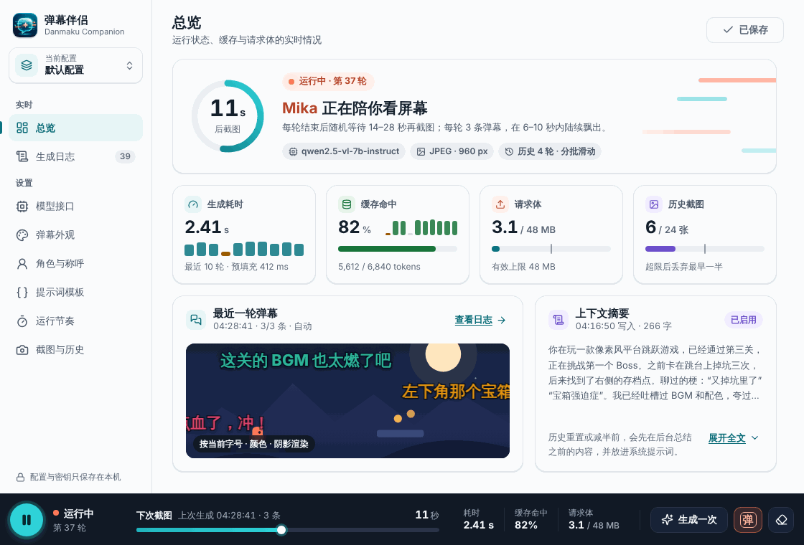
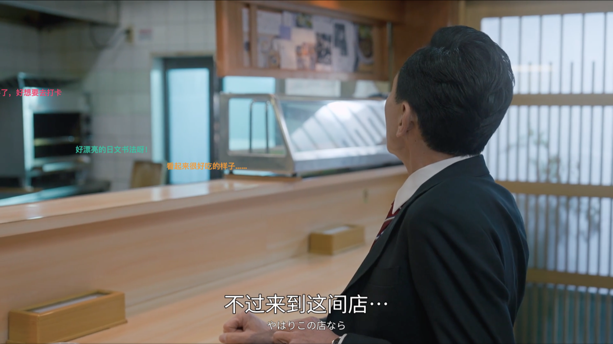

# Danmaku Companion

Danmaku Companion is a local-first desktop overlay that generates short danmaku
comments from a vision-capable, OpenAI-compatible model provider.





## What It Does

- Renders a transparent, click-through danmaku overlay on macOS and Windows,
  placing comments in non-overlapping lanes.
- Talks to local or hosted OpenAI-compatible endpoints, including LM Studio style
  servers.
- Can send screen captures to vision models when the user enables the vision
  payload.
- Supports randomized generation intervals, randomized release windows, fixed
  comments per cycle, and local generation logs.
- Waits a few seconds after Start (`启动延迟`, default 5 s) before the first
  capture, so the first screenshot shows your content rather than the app's
  own settings window.
- Keeps conversation history (optionally with screenshots) while staying under
  the server's request size limit and reusing its prompt cache.
- Stores configuration locally and does not include telemetry.

## History Screenshots, Prompt Cache and Request Size

Each cycle sends the system prompt, the history window and the current
screenshot. Servers with prefix caching (llama.cpp, LM Studio, vLLM and most
gateways in front of them) only reuse the longest unchanged beginning of the
request, so the app keeps history append-only for as long as it can:

- **历史模式 (history mode).** `满额重置` (reset-on-limit) appends rounds and
  starts over when the window is full. `分批滑动（缓存友好）` (batch-sliding)
  drops the oldest half of the window at once, so it keeps context and only
  misses the cache once per half window. `逐轮滑动` (sliding) drops one round
  every cycle once full, which changes the start of the request and misses the
  cache on every round; avoid it when history screenshots are on.
- **保留历史截图 (history screenshots).** Every screenshot in history is sent
  again as base64 in every request. Two limits keep this bounded:
  `历史截图上限 (张)` (default 24) and `请求体上限 (MB)` (default 48). While
  both hold nothing changes. When one is exceeded, the oldest screenshots are
  dropped in one batch until the request is at half of each limit; their text
  stays in history with an "earlier screenshot omitted" note. That round costs
  one full re-prefill, and the following rounds hit the cache again.
- **HTTP 413.** The exact body size is checked before sending. If a server
  still rejects the size (for example llm_api's `exceeds max_body of
  67108864`), the app learns the limit it reports (or halves the rejected size
  when it does not say), compacts history and retries once. A connection reset
  while uploading 8 MiB or more is retried once with half the body; that limit
  is not kept, but the compaction is, so later requests start smaller. Failures that would
  repeat (HTTP 400/413/422, such as a context overflow) shrink history before
  the next cycle; timeouts, 429 and 5xx keep it.
- **上下文摘要 (context summary, off by default).** With `满额重置` or
  `分批滑动`, the app sends one extra request one round before the window
  starts over or is halved. That request repeats the same system prompt and
  history (so it reuses the server's cached prefix) and asks for a short
  summary: what the user has been doing, memorable moments, running jokes, the
  gist of comments already sent. The summary is added to the system prompt only
  when the window actually starts over or halves. That moment already misses
  the cache, so the summary costs no extra re-prefill. Each summary includes
  the previous one, so the timeline accumulates. If the summary is still
  running at the compaction, the next cycle waits up to 20 s for it. The
  length (`摘要长度上限`, default 400 characters) and the instruction
  (`上下文摘要提示词`) can be changed. Summary requests show up in the
  generation log as `摘要`.
- **Choosing a format.** PNG screenshots are often 10x the bytes of JPEG for
  the same image tokens. With history screenshots on, prefer JPEG; every cycle
  uploads the whole request.

The status bar and generation log show the request size against the effective
limit, the history screenshots sent, compactions, and cached / prompt tokens
(read from `usage` or llama.cpp `timings`), so the effect of these settings on
the cache is visible.

## Privacy Notes

Screenshots are captured only when vision payload is enabled. By default the
overlay is excluded from screenshots (`截图时排除弹幕层`), so the model never
reads its own danmaku; on Windows this needs Windows 10 2004 or later and also
hides the danmaku from screen recorders such as OBS. Turn it off if you want
to record the danmaku. API keys and
provider settings live in the local app configuration, not in this repository.
The app ignores `.env` files and release artifacts by default.

On macOS, screen capture requires the system Screen Recording permission for the
installed app bundle.

## Development

```bash
npm install
npm run typecheck   # renderer, main process and tests
npm test            # vitest unit tests (npm run test:watch to iterate)
npm run dev
```

Pure logic (prompt building, response parsing, request budgeting, history,
config sanitizing, overlay lanes) lives in modules without Electron imports and
is covered by unit tests under `test/`. CI runs typecheck, tests and build on
Ubuntu and Windows and packages an unpacked Windows build.

## Packaging

```bash
npm run package:mac
npm run package:win
```

macOS builds are signed after packaging when a code signing identity is
available. To choose one explicitly, set `DANMAKU_CODESIGN_IDENTITY`.

Windows builds use Electron Builder's NSIS target.

## Status

The app is actively evolving around screen-aware comments, natural release
timing, and local model workflows.
